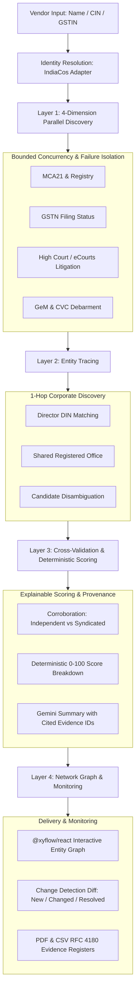

# VendorTrace

> **Evidence-Backed B2B Vendor Due Diligence for Indian Procurement & Compliance**
> 
> *"We don't just find risk signals. We trace who is behind them, prove every claim across independent sources, and clearly separate verified evidence from findings that need human review."*

[](#)
[](#)
[](#)
[](#)

---

## Table of Contents
1. [Product Overview](#product-overview)
2. [The 4-Layer Architecture](#the-4-layer-architecture)
3. [6.5-Hour Hackathon MVP Alignment](#65-hour-hackathon-mvp-alignment)
4. [Deterministic Demo Mode](#deterministic-demo-mode)
5. [Professional Workflows & Exports](#professional-workflows--exports)
6. [Security & Isolation](#security--isolation)
7. [Integrations & Environment Secrets](#integrations--environment-secrets)
8. [Storage Architecture](#storage-architecture)
9. [Local Development & Testing](#local-development--testing)
10. [Cloud Run Deployment Guide](#cloud-run-deployment-guide)
11. [6-Step Hackathon Pitch & Demo Script](#6-step-hackathon-pitch--demo-script)

---

## Product Overview

Indian procurement teams face massive blindspots when evaluating suppliers: shell companies, shared directors behind disqualified entities, undisclosed litigation, and sudden debarment on government procurement portals like GeM.

**VendorTrace** solves this through a zero-hallucination, evidence-backed diligence engine:
- **Never fabricates claims**: LLMs are restricted from independently declaring vendors fraudulent. Risk scores are deterministic (0–100).
- **Independent cross-validation**: Syndicated and mirrored press releases never count as multiple independent sources.
- **Explainable scoring**: If upstream data coverage is inadequate, VendorTrace displays `INSUFFICIENT_COVERAGE` rather than a reassuring low score. Absence of data never reduces risk.
- **Zero guilt by association**: Related corporate entities discovered via director DIN or shared addresses are leads for review, not proof of wrongdoing.

---

## The 4-Layer Architecture



### Layer 1: Multi-Dimension Discovery & Failure Isolation
- Orchestrates parallel checks across four dimensions: **Company Registry / GST**, **Court Litigation**, **Debarment / Blacklist (GeM, CVC)**, and **Negative Regulatory News**.
- Bounded concurrency pool (max 3 concurrent jobs), a configurable 120-second overall deadline, and configurable 45-second per-agent deadlines prevent cascading failures. Each agent gets at most two attempts with bounded backoff; cancellation stops active requests and preserves completed task results.
- If one portal times out or encounters upstream 5xx errors, other dimensions complete unaffected and the gap is transparently recorded.

### Layer 2: Evidence-Backed Entity Tracing
- Traverses 1-hop corporate relationships using confirmed identifiers (8-digit Director DINs, registered office addresses, linked CINs).
- **Zero-Name Conflation**: Common Indian director names without confirmed DINs are tagged `same_name_candidate` and are **never** automatically merged.
- Graph edges specify exact evidentiary basis: `LINKED_REGISTRY_ID`, `SHARED_DIRECTOR_DIN`, `SHARED_REGISTERED_ADDRESS`, or `UNVERIFIED_CANDIDATE`.

### Layer 3: Cross-Validation & Deterministic Risk Scoring
- Strict corroboration rules:
  - `multiple_independent_sources`: Requires at least 2 genuinely independent publisher domains with matching corporate identifiers.
  - `single_source_review`: Requires human compliance officer sign-off.
  - `conflicting_sources`: Surfaces opposing claims (e.g. pending litigation vs dismissed on appeal).
- **Deterministic 0–100 Risk Score**:
  - Severity points (0–40)
  - Confidence points (0–30)
  - Recency points (0–15)
  - Identity match points (0–15)
- Summaries generated by Gemini strictly reference citation IDs (`[evi_...]`). If Gemini is unavailable, deterministic rule summaries take over.

### Layer 4: Interactive Graph, Monitoring & Workflows
- **Interactive Network Graph**: Rendered via `@xyflow/react` with accessible table fallback. Red/amber colors indicate verified risk; unverified candidate links remain neutral slate gray.
- **Monitoring & Diff Engine**: Re-running an investigation compares the current run against the historical baseline, detecting `NEW`, `CHANGED`, and `RESOLVED` signals.
- **Audit History**: Vendor profile tracks longitudinal posture and trend (`IMPROVING`, `DETERIORATING`, `STABLE`).


## Deterministic Demo Mode

VendorTrace includes a **zero-dependency, offline-capable Demo Mode** designed for live stage presentations where external networks or API quotas might fluctuate.

- **Synthetic Identity**: Target is `Acme Horizon Technologies Pvt Ltd (SYNTHETIC DEMO)` with synthetic CIN `U99999XX2024PTC999999`, GSTIN `99AAAAA9999A1Z5`, and DIN `99999999`. Real public companies are never used for synthetic risk signals.
- **Prominent Disclaimers**: Every demo screen, PDF report, and CSV register displays the notice:
  > `DEMO DATA — SYNTHETIC EXAMPLE: Entirely fictional corporate entity and evidence for demonstration purposes. Not real findings or allegations.`
- **Switch to Live**: Toggle seamlessly to live mode with provider health checks and connectivity verification.

---

## Professional Workflows & Exports

### Multi-Attribute Search & Filter
Compliance officers can filter past investigations across:
- Vendor name (case-insensitive substring)
- Identifier (CIN, GSTIN, PAN)
- Status (`COMPLETED`, `PARTIAL_FAILURE`, `IN_PROGRESS`, `FAILED`)
- Review Priority (`ELEVATED_REVIEW_PRIORITY`, `REVIEW_RECOMMENDED`, `INSUFFICIENT_COVERAGE`, etc.)
- Risk Dimension (`company_registry`, `court_litigation`, `blacklist_debarment`, `adverse_media`)
- Date ranges with pagination (up to 50 items/page)

### Executive PDF Report (`jspdf`)
- Formatted compliance report with executive risk index, factor contributions, dimension coverage cards, and formal legal disclaimer.
- Includes report ID, audit timestamps, and data limitations notice.
- Rejects empty exports to prevent unpopulated reports from being circulated.

### CSV Evidence Register (RFC 4180 Compliant)
- Structured register with one row per evidence signal:
  `Vendor`, `Dimension`, `Title`, `Risk Level`, `Severity (1-5)`, `Verification Status`, `Source URL`, `Source Domain`, `Snippet`, `Captured Date`, `Identity Match`, `Review Action`, `Report ID`.
- Sanitized against CSV formula injection (`=`, `+`, `-`, `@`).

---

## Security & Isolation

- **SSRF Regulatory Allowlist**: Server-side HTTP clients only connect to pre-approved regulatory endpoints (`mca.gov.in`, `gst.gov.in`, `gem.gov.in`, `cvc.gov.in`, `ecourts.gov.in`, `indiacos.com`, `agent.tinyfish.ai`).
- **Payload & Rate Limiting**: Strict 50KB request payload ceiling and client IP rate limiting (30 requests/minute) protect upstream quotas.
- **Prompt Injection Defense**: Vendor-supplied names and notes are stripped of jailbreak delimiters (`ignore previous instructions`, `system prompt:`) before reaching Gemini.
- **Audit Ledger**: In-memory security audit ledger logs high-risk actions, authentication checks, and export activities with timestamp and IP provenance.

---

## Integrations & Environment Secrets

VendorTrace keeps all credentials strictly server-side. **No API keys or auth headers are ever exposed to the client bundle.**

### Environment Variables

| Variable Name | Required | Description |
|---|---|---|
| `GEMINI_API_KEY` | Recommended | Powers deterministic evidence summaries and brief compliance briefs. |
| `TINYFISH_API_KEY` | Required | Required for live web crawling, litigation dockets, and SSE streaming. |
| `INDIACOS_API_KEY` | Optional in Demo | Required for live MCA21 master data and Director DIN lookups. |
| `VENDORTRACE_INVESTIGATION_TIMEOUT_MS` | Optional | Overall live investigation deadline in milliseconds (default and maximum: `120000`). |
| `VENDORTRACE_AGENT_TIMEOUT_MS` | Optional | Per-agent deadline in milliseconds (default: `45000`, maximum: `120000`). |
| `VENDORTRACE_AGENT_MAX_ATTEMPTS` | Optional | Total attempts per agent, including the first attempt (default and maximum: `2`; minimum: `1`). Authentication failures are never retried. |
| `VENDORTRACE_AGENT_RETRY_BACKOFF_MS` | Optional | Base retry backoff in milliseconds (default: `300`, maximum: `2000`). |
| `PORT` | Optional | Application listening port (default: `3000`). |
| `NODE_ENV` | Optional | Set to `production` or `development`. |
| `ENABLE_AUTH` | Optional | Set to `true` to enforce Google token authentication on API routes. |
| `GOOGLE_APPLICATION_CREDENTIALS` | Reserved | No Firestore repository adapter is wired in the current implementation; setting this variable alone does not enable durable storage. |

---

## Storage Architecture

The shipped implementation currently wires **`DevInMemoryRepositoryAdapter` only**:

- It is zero-configuration and seeded with deterministic demo datasets.
- Vendor and investigation records are stored in process memory and may reset when the server restarts.
- `firestore.rules` is included as a rules file, but a rules file alone does not implement database persistence.
- **No `FirestoreRepositoryAdapter` is present or registered in this build.** Setting `FIREBASE_CONFIG` or `GOOGLE_APPLICATION_CREDENTIALS` alone does not make data durable.
- Implement and test an actual persistent repository adapter, access rules, and tenant isolation before describing this as durable multi-user SaaS or deploying with real customer data.

---

## Local Development & Testing

### Prerequisites
- Node.js (v18 or higher recommended; v20+ supported)
- npm (v9+)

### Installation & Setup

```bash
# 1. Extract the full project ZIP (or clone your repository) and enter the project directory
cd vendortrace
npm ci

# 2. Configure environment
cp .env.example .env
# (Edit .env to add API keys locally. Never commit or share this file.)

# 3. Execute the full test suite (15 suites; rerun locally for current results)
npm test

# 4. Run TypeScript lint check
npm run lint

# 5. Start development server (serves frontend and backend concurrently)
npm run dev
```

Visit `http://localhost:3000` in your browser.

---

## Cloud Run Deployment Guide

VendorTrace is packaged as a unified Node.js Express + Vite application that compiles into a single deployable container.

> [!IMPORTANT]
> **Controlled Deployment Protocol**: Do not deploy automatically to Cloud Run without confirming project ID, region, secret bindings, and access controls. This build has no verified durable storage and application-level multi-tenant authorization is not production-cleared. Keep Cloud Run private; do not enable unauthenticated public access.

### Build and Test Verification Before Deployment
```bash
# Confirm TypeScript compilation
npm run lint

# Run all 15 test suites
npm test

# Build production bundle into /dist
npm run build
```

The production bundle may report a large-chunk advisory; this does not fail the build. A successful build does not establish that a live provider investigation completed.

### Google Cloud Run Deployment Steps

```bash
# 1. Set Google Cloud project configuration
gcloud config set project YOUR_GCP_PROJECT_ID
gcloud config set run/region us-central1

# 2. Deploy directly using Cloud Build and Cloud Run
gcloud run deploy vendortrace \
  --source . \
  --platform managed \
  --port 3000 \
  --no-allow-unauthenticated \
  --set-env-vars NODE_ENV=production \
  --set-secrets GEMINI_API_KEY=GEMINI_API_KEY:latest \
  --set-secrets TINYFISH_API_KEY=TINYFISH_API_KEY:latest \
  --set-secrets INDIACOS_API_KEY=INDIACOS_API_KEY:latest
```

<div align="center">
  <sub>Built with rigor for Indian Procurement & Compliance Officers.</sub>
</div>
